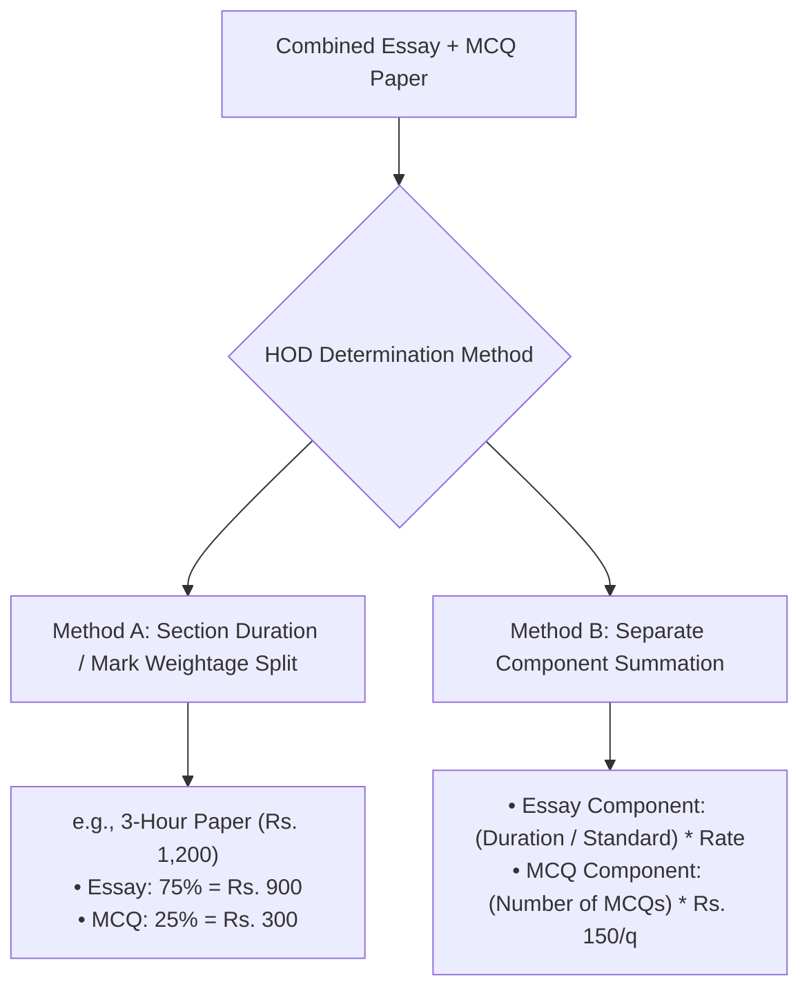
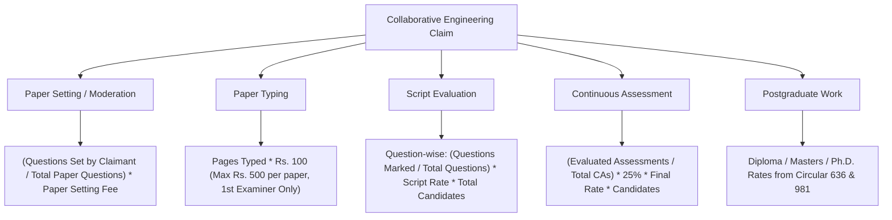

# University of Ruhuna — Faculty of Engineering
## Examination & Continuous Assessment (CA) Payment Specification
### Comprehensive Remuneration Guide for Paper Setting, Moderation, Typing, Marking, Continuous Assessments, Combined Papers, and Postgraduate Examinations

---

> [!NOTE]
> **Regulatory Foundation:**  
> This specification is synthesized directly from University Grants Commission (UGC) **Circular No. 981** (effective 01 March 2012), **Circular No. 681** (amendment for Continuous Assessment), **Circular No. 636** (foundational framework & Postgraduate provisions), and Faculty of Engineering internal examination administration guidelines. All non-engineering faculty rates (Medical, Dental, Veterinary, Law, B.Ed.) and non-academic staff allowances (invigilators, hall attendants, peons) are excluded.

---

## 1. Executive Summary & Faculty Scope

In the **Faculty of Engineering, University of Ruhuna**, academic staff (Lecturers, Senior Lecturers, Heads of Department, and Visiting/External Examiners) perform examination duties across:
1. **Undergraduate Programs:** B.Sc. Engineering Honours (4-year Special Degree across Civil, Electrical & Information, Mechanical & Manufacturing, Computer Engineering, and Interdisciplinary Studies).
2. **Postgraduate Programs:** Postgraduate Diplomas, Master of Science (M.Sc. / M.Eng), Master of Philosophy (M.Phil.), and Doctor of Philosophy (Ph.D.).

Unlike simple single-examiner models, Engineering modules frequently feature **multi-examiner workflows** where:
- **Paper Setting & Moderating** is shared among module coordinators and co-lecturers by question allocation.
- **Combined Essay + MCQ Papers** require proportionate calculation governed by the Head of Department (HOD).
- **Typing** is handled by the primary setting teacher.
- **Paper Marking** is divided either question-wise (e.g., Examiner A marks Q1 & Q2 across all 120 scripts; Examiner B marks Q3, 4, 5) or batch-wise.
- **Continuous Assessment (CA)** is carried out throughout the semester (quizzes, mid-semester exams, lab assessments, design assignments) and claimed alongside the final exam.
- **Undergraduate Final Year Projects (Dissertations)** are evaluated under the 4-year Special Degree rate.
- **Postgraduate Examinations & Theses** are compensated under Circular 636 and Circular 981 schedules.

---

## 2. Undergraduate Examination Payment Rates (Circular 981)

### A. Question Paper Setting & Moderation (Schedule I)

| Paper Type & Duration | Setting Rate (LKR) | Moderating Rate (LKR) | Notes |
| :--- | :--- | :--- | :--- |
| **Essay Paper — 1 Hour** | Rs. 400/= | Rs. 400/= | Divided proportionately if joint |
| **Essay Paper — 2 Hours** | Rs. 800/= | Rs. 800/= | Divided proportionately if joint |
| **Essay Paper — 3 Hours** | Rs. 1,200/= | Rs. 1,200/= | Standard for most engineering core modules |
| **Paper Exceeding 3 Hours** | Rs. 400/= per additional hour | Rs. 400/= per additional hour | Pro-rata for extended duration |
| **Multiple Choice Question (MCQ)** | Rs. 150/= per question | Rs. 150/= per question | Claimed per question set |
| **Combined Essay + MCQ Paper** | Proportionate payment | Proportionate payment | **Determined by Head of Department (HOD)** (See Section 3) |

> [!IMPORTANT]
> **Translation & Scrutiny of Translation:**  
> Engineering examinations at the University of Ruhuna are conducted entirely in the **English medium**. Consequently, **Translation** (Rs. 200–500) and **Scrutiny of Translation** (Rs. 25–40) are **not applicable** and must be hidden/excluded from Engineering claim forms.

---

### B. Question Paper Typing (Schedule I)

| Activity | Rate (LKR) | Maximum Ceiling | Entitled Role |
| :--- | :--- | :--- | :--- |
| **Typing of Question Paper** | **Rs. 100/= per page** | **Rs. 500/= per question paper** | **1st Examiner / Teacher setting the paper only** |

- **Moderators are strictly prohibited** from claiming typing allowances (`Moderator -> Typing ✗`).
- If multiple examiners type different sections of the paper, the combined total for the paper cannot exceed **Rs. 500/=**.

---

### C. Script Marking & Answer Script Evaluation (Schedule II)

| Examination Stage / Paper Type | Internal Examiner (1st Examiner) | 2nd Examiner (Internal) | External Examiner |
| :--- | :--- | :--- | :--- |
| **First & Qualifying Examinations** (Semesters 1 & 2) | **Rs. 80/=** per script | **Rs. 80/=** per script | **Rs. 150/=** per script |
| **Degree Examinations** (Semesters 3 through 8) | **Rs. 100/=** per script | **Rs. 100/=** per script | **Rs. 150/=** per script |
| **MCQ Paper Script Marking** | **Rs. 40/=** per script | **Rs. 40/=** per script | **Rs. 40/=** per script |
| **Practical Examination / Lab Assessment** | **Rs. 100/=** per candidate script | **Rs. 100/=** per candidate script | **Rs. 150/=** per candidate script |

> [!NOTE]
> Rule 3(b) of Circular 981 stipulates: *"The practical examination of a candidate shall be remunerated as if it were the marking of a script."*

---

### D. Continuous Assessment (CA) Evaluation (Circular 681 & Circular 636)

- **Rate Formulation:**  
  $$\text{CA Rate per Assessment per Script} = 25\% \times \text{Final Degree Script Rate}$$
  - For Degree Examinations (Final Exam script rate = Rs. 100/=):
    $$\text{Rate per CA Assessment per Script} = 25\% \times 100 = \text{Rs. } 25/=\text{ per student}$$
  - For First/Qualifying Examinations (Final Exam script rate = Rs. 80/=):
    $$\text{Rate per CA Assessment per Script} = 25\% \times 80 = \text{Rs. } 20/=\text{ per student}$$
- **Statutory Limits:**
  - Maximum of **four (04) assessments** per course unit per academic year.
  - Four CA assessments evaluated at 25% equal 100% of a final script rate ($4 \times \text{Rs. } 25 = \text{Rs. } 100$ per student).
- **Submission Timing:** Continuous Assessment claims must be submitted alongside the final examination claim.

---

### E. Undergraduate Dissertations & Final Year Projects (Circular 981, Page 6)

| Project Category | Degree Type | Rate per Dissertation | Eligible Roles |
| :--- | :--- | :--- | :--- |
| **B.Sc. Engineering Final Year Research Project (FYP)** | **Special Degree (4 Years)** | **Rs. 600/= per report** | Internal & External Examiners |
| Comprehensive Design Projects (CDP) | Special Undergraduate | Rs. 600/= per report | Project Supervisors / Reviewers |

---

## 3. Combined Essay + MCQ Papers (HOD Determination Rule)

### Regulatory Provision (Extract from Circular No. 981, Note 1):
> *"Essay type and M.C.Q. combined in one question paper for setting/moderating/translating: Proportionate payments to be made depending on the number of questions and/or duration of paper as determined by the Head of the Department."*

In modern engineering curricula, examination papers frequently combine Section A (Multiple Choice Questions) and Section B (Structured Essay / Computational Questions).

### Determination Mechanisms by Head of Department (HOD):

#### Method A: Percentage / Time Weighting Split (As indicated on Faculty Reference Notes: `75% / 25%`)
- **Example:** A 3-Hour examination paper with total standard setting fee of Rs. 1,200/=.
  - HOD assigns: **75% to Essay Section** and **25% to MCQ Section**.
  - Total Essay Setting Budget = $0.75 \times 1,200 = \text{Rs. } 900/=$.
  - Total MCQ Setting Budget = $0.25 \times 1,200 = \text{Rs. } 300/=$.
  - If Lecturer A sets 4 Essay questions and Lecturer B sets 20 MCQs:
    - Lecturer A claims: Rs. 900/=
    - Lecturer B claims: Rs. 300/=
    - Combined Total = Rs. 1,200/=.

#### Method B: Component-Based Proportionate Calculation
- **Example:** A 3-Hour paper containing:
  - 2 hours allocated to 4 Essay questions $\rightarrow$ Essay Setting Rate (2 hrs) = Rs. 800/=.
  - 1 hour allocated to 20 MCQs $\rightarrow$ Set at Rs. 150/question or proportionate duration.
  - HOD certifies the ratio and individual examiner contributions on the claim form.

#### Script Marking for Combined Papers:
- **MCQ Section Marking:** Fixed statutory rate of **Rs. 40/= per script** (or proportionate if computer-graded / partial).
- **Essay Section Marking:** Standard degree script rate of **Rs. 100/= per script** (split question-wise among essay examiners).

---

## 4. Postgraduate Examinations & Theses (Circular No. 636 & Circular No. 981)

The Faculty of Engineering conducts Postgraduate studies including **P.G. Diploma, Master of Science (M.Sc. / M.Eng), Master of Philosophy (M.Phil.), and Doctor of Philosophy (Ph.D.)**.

### A. Postgraduate Examination Question Paper Setting & Script Marking (Circular 636, Schedule IV)

| Postgraduate Examination Level | Setting / Moderation Rate | Marking / Assessing Rate | Oral / Clinical Examinations |
| :--- | :--- | :--- | :--- |
| **Postgraduate Diploma** | **Rs. 300/=** per paper | **Rs. 20/=** per script | Rs. 40/= per candidate |
| **Masters (M.Sc. / M.Eng)** | **Rs. 360/=** per paper | **Rs. 30/=** per script | **Rs. 40/=** per candidate |
| **M.D. / M.S.** | Rs. 400/= per paper | Rs. 20/= per script | — |

- **Multi-Examiner Split:** If two or more examiners set or mark a postgraduate paper, the fee is divided proportionately according to questions set/marked.

---

### B. Reading & Evaluation of Postgraduate Dissertations and Theses (Circular 981, Page 9 / Circular 636)

| Degree Duration & Level | Local Examiner (University or Non-University) | Foreign Examiner | Notes |
| :--- | :--- | :--- | :--- |
| **Degrees of 1 Year Duration** (e.g. Taught M.Sc.) | **Rs. 2,000/=** | **US $200** | Full thesis evaluation |
| **Degrees of 2 Years Duration** (e.g. M.Phil., 2-Year M.Sc. with Research) | **Rs. 3,000/=** | **US $350** | Full thesis evaluation |
| **Degrees of 3 Years Duration** (e.g. Ph.D. Doctoral Dissertation) | **Rs. 5,000/=** | **US $440** | Full dissertation evaluation |
| **Re-evaluation (Second or Subsequent Time)** | **50% of the above fee** | **50% of the above fee** | Paid when evaluating a revised resubmission |

---

### C. Postgraduate Oral / Viva Voce Examinations

| Examination Category | Local Examiner | Foreign Examiner |
| :--- | :--- | :--- |
| **Ph.D. Oral / Viva Voce Examination** | **Rs. 200/=** per candidate (or circular schedule) | **USD 200** per candidate |
| **M.Sc. / M.Phil Oral / Viva Examination** | **Rs. 100/=** per candidate per examiner | — |

---

### D. Supervision of Postgraduate Research Work (Circular 636, Page 10)

| Degree Program | Supervision Honorarium (Upon Successful Completion) |
| :--- | :--- |
| **Ph.D. Degree** | **Rs. 2,000/=** per student |
| **M.Sc. / M.Phil. Degree (2 Years)** | **Rs. 1,000/=** per student |
| **Master's Part-Dissertation or P.G. Diploma Project** | **Rs. 600/=** per student |

- **Joint Supervision:** Where there is more than one supervisor, the fee is divided in a suitable manner agreed upon by the supervisors and certified by the Head of Department.

---

## 5. Mathematical Models for Multi-Examiner Proportionality

UGC Circular 981 Rule 2 stipulates:
> *"Where two or more examiners are jointly responsible for a paper the fee for setting the paper and marking/assessing of answer scripts shall be divided proportionately among them."*

---

### Model 1: Multi-Person Paper Setting (Question-Proportionate)

$$\text{Claimant Setting Fee} = \left( \frac{Q_{\text{claimed}}}{Q_{\text{total}}} \right) \times \text{Standard Paper Setting Fee}$$

#### Concrete Example:
- **Module:** CE3010 — Structural Analysis (3-Hour Paper, Standard Fee = Rs. 1,200/=)
- **Total Questions in Paper:** 5 Questions
- **Lecturer A sets:** 2 Questions (Questions 1 & 2) $\rightarrow \left(\frac{2}{5}\right) \times 1,200 = \text{Rs. } 480/=$
- **Lecturer B sets:** 3 Questions (Questions 3, 4 & 5) $\rightarrow \left(\frac{3}{5}\right) \times 1,200 = \text{Rs. } 720/=$

---

### Model 2: Multi-Person Question Paper Typing

$$\text{Claimant Typing Fee} = \min \left( \text{Pages Typed by Claimant} \times \text{Rs. } 100/=, \ \text{Rs. } 500/= - \sum \text{Previously Claimed Typing} \right)$$

- **Precondition:** Claimant must be the 1st Examiner / Setting Teacher.
- If Lecturer A types 3 pages and Lecturer B types 2 pages of a 5-page paper:
  - Lecturer A = $3 \times 100 = \text{Rs. } 300/=$
  - Lecturer B = $2 \times 100 = \text{Rs. } 200/=$
  - Total = Rs. 500/= (Capped at statutory ceiling).

---

### Model 3: Multi-Person Script Marking (Question-Wise vs. Batch-Wise)

#### Case 3A: Question-Wise Marking (Most Common in Ruhuna Engineering)
Examiners evaluate specific questions across the entire student cohort.

$$\text{Marking Fee} = \left( \frac{Q_{\text{marked}}}{Q_{\text{total}}} \right) \times \text{Script Rate} \times N_{\text{students}}$$

- **Parameters:**
  - $Q_{\text{total}} = 5$ questions
  - $N_{\text{students}} = 120$ student scripts
  - Degree Exam Script Rate = Rs. 100/=
  - **Examiner 1** marks Questions 1, 2, 3 ($Q_{\text{marked}} = 3$):
    $$\text{Fee}_1 = \left(\frac{3}{5}\right) \times 100 \times 120 = 0.6 \times 12,000 = \text{Rs. } 7,200/=$$
  - **Examiner 2** marks Questions 4, 5 ($Q_{\text{marked}} = 2$):
    $$\text{Fee}_2 = \left(\frac{2}{5}\right) \times 100 \times 120 = 0.4 \times 12,000 = \text{Rs. } 4,800/=$$
  - **Combined Disbursed:** $\text{Rs. } 7,200 + \text{Rs. } 4,800 = \text{Rs. } 12,000/= = 120 \times 100$.

#### Case 3B: Batch-Wise Marking
Examiners divide physical student scripts:
$$\text{Marking Fee} = N_{\text{assigned scripts}} \times \text{Script Rate}$$

---

### Model 4: Continuous Assessment (CA) Proportionality

$$\text{CA Fee} = \sum_{i=1}^{M_{\text{assessments}}} \left[ \left( \frac{Q_{\text{marked}, i}}{Q_{\text{total}, i}} \right) \times (0.25 \times \text{Final Script Rate}) \times N_{\text{students}, i} \right]$$

- Where $M_{\text{assessments}} \le 4$.
- If Lecturer A evaluated 2 Quizzes out of 4 total CAs for 100 students:
  $$\text{CA Fee} = 2 \times (0.25 \times 100) \times 100 = 2 \times 25 \times 100 = \text{Rs. } 5,000/=$$

---

## 6. Proposed Claim Form Structure & Fields

To accommodate single-examiner, multi-examiner, combined paper, and postgraduate claims seamlessly:

### Section 1: Academic & Examination Context
- Program Level: `[ ] Undergraduate (B.Sc. Eng)` `[ ] Postgraduate Diploma` `[ ] Masters (M.Sc./M.Eng)` `[ ] M.Phil / Ph.D.`
- Academic Year & Semester
- Course Code & Title
- Total Student Cohort Count ($N$)

### Section 2: Paper Setting & Moderation
- Role: `[ ] 1st Examiner (Setter)` `[ ] 2nd Examiner` `[ ] Moderator`
- Paper Category:
  - `(o) Standard Essay Paper` (1 hr / 2 hrs / 3 hrs / >3 hrs)
  - `( ) MCQ Paper Only` (Number of questions @ Rs. 150/q)
  - `( ) Combined Essay + MCQ Paper`
    - HOD Determination Mode: `[Percentage Split]` or `[Component-based]`
    - Essay Weighting % & MCQ Weighting %
- Multi-Examiner Sharing:
  - `Is this paper setting shared?` `[ Yes ]` `[ No ]`
  - Total Questions in Paper ($Q_{\text{total}}$)
  - Questions Set by You ($Q_{\text{claimed}}$)

### Section 3: Question Paper Typing (1st Examiner Only)
- `Did you type the paper?` `[ Yes ]` `[ No ]`
- Pages Typed (Rate Rs. 100/page, maximum cap Rs. 500/=)

### Section 4: Script Marking & Assessment
- Script Category: `[ ] Degree Exam (Rs. 100)` `[ ] First/Qualifying (Rs. 80)` `[ ] MCQ Script (Rs. 40)` `[ ] Practical Exam (Rs. 100)` `[ ] PG Script (Diploma: Rs. 20, Masters: Rs. 30)`
- Marking Mode:
  - `(o) Question-wise split:` Total questions in paper, Questions marked by you, Total student count.
  - `( ) Batch split:` Number of full scripts marked by you.

### Section 5: Continuous Assessment (CA)
- Dynamic table (up to 4 assessments max):
  - Assessment Title / Type (Quiz, Lab, Mid-term, Assignment)
  - Student Cohort Size
  - Percentage or Questions evaluated by claimant

### Section 6: Research Dissertations & Theses (UG & PG)
- `[ ] Undergraduate 4th-Year FYP Dissertation (Special Degree)`: Rs. 600/= per report
- `[ ] Postgraduate Taught Masters Dissertation (1 Year)`: Rs. 2,000/= (Foreign: $200)
- `[ ] M.Phil Thesis (2 Years)`: Rs. 3,000/= (Foreign: $350)
- `[ ] Ph.D. Doctoral Dissertation (3 Years)`: Rs. 5,000/= (Foreign: $440)
- `[ ] Postgraduate Research Supervision`: (Ph.D. Rs. 2,000 | M.Sc./M.Phil Rs. 1,000 | Diploma Rs. 600)
